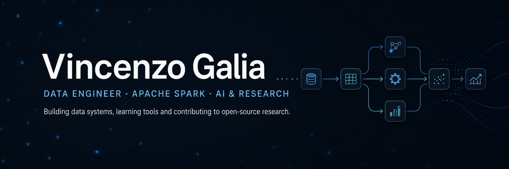

  

---

## 👋 About Me

I'm a **Data Engineer** interested in distributed systems, Apache Spark, applied AI and research-oriented software.

I enjoy turning complex technical concepts into practical tools and exploring the intersection between **data engineering, AI systems and scientific research**.

---

## ⚡ Featured Project

### [Databricks Spark 3.5 Certification Study System](https://github.com/Galius5136/databricks-spark-3.5-cert-prep)

An agent-powered study system built around the **Databricks Certified Associate Developer for Apache Spark 3.5** curriculum.

It covers:

- Spark architecture
- DataFrames & Spark SQL
- Performance tuning
- Structured Streaming
- Spark Connect
- Pandas API on Spark
- Spark 3.5 features
- Quizzes, mock exams and progress tracking

---

## 🔬 Open Source & Research

### BenchFlow

Contributing to **[BenchFlow](https://github.com/benchflow-ai/benchflow)**, an open-source ecosystem for AI agent environments, evaluations and research infrastructure.

`AI Agents` · `Evaluation` · `Research Infrastructure`

### FrontierPhysics

Contributing to **[FrontierPhysics](https://github.com/benchflow-ai/FrontierPhysics)**, a research project exploring the evaluation of advanced AI systems on frontier-level physics problems.

`AI Evaluation` · `Scientific Reasoning` · `Physics`

---

## 🛠️ Tech

**Data Engineering**

`Python` · `SQL` · `Apache Spark` · `PySpark` · `Databricks` · `Apache Airflow`

**Cloud & Data**

`AWS` · `PostgreSQL` · `PL/pgSQL`

**Software & AI**

`C#` · `AI Agents` · `LLM Evaluation`

---

## 🧭 Current Interests

- Distributed data processing
- AI agent evaluation
- Scientific AI benchmarks
- Applied machine learning
- Open-source research

---

### Build things. Understand how they work. Contribute back.

